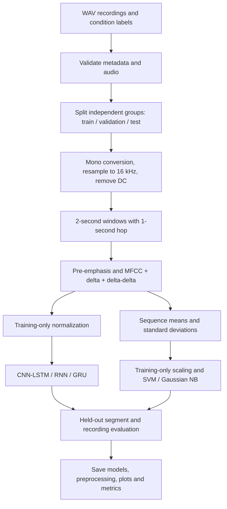

# Gearbox fault prediction using smartphone voice recording

This project was developed as a **minor project** in the **Department of Mechanical
Engineering, NIT Jamshedpur**, by **Shikhar Singh**.

**A complete Jupyter workflow for classifying normal, tooth-fault and bearing-fault recordings.**

Record gearbox sound, extract acoustic features, train five classifiers, and compare
their predictions on independent held-out recordings. The project implements the
acoustic classification methodology with explicit checks
against leakage between training and testing.

**[Open the notebook](gearbox_fault_prediction.ipynb)** ·
**[View the metadata template](data/metadata.example.csv)**

## Contents

- [Quick start](#quick-start)
- [Repository guide](#repository-guide)
- [Implementation methodology](#implementation-methodology)
- [Models and training](#models-and-training)
- [Evaluation and sample results](#evaluation-and-sample-results)
- [Use real recordings](#use-real-recordings)
- [Code walkthrough](#code-walkthrough)
- [Saved artifacts and prediction](#saved-artifacts-and-prediction)
- [Development and validation](#development-and-validation)
- [Limitations and experimental reporting](#limitations-and-experimental-reporting)

## Quick start

Use **Python 3.12**. From the repository folder in Windows PowerShell:

```powershell
py -3.12 -m venv .venv
.\.venv\Scripts\python.exe -m pip install -r requirements.txt
.\.venv\Scripts\python.exe -m jupyter lab
```

On Linux or macOS:

```bash
python3.12 -m venv .venv
.venv/bin/python -m pip install -r requirements.txt
.venv/bin/python -m jupyter lab
```

Open `gearbox_fault_prediction.ipynb`, choose the environment's Python kernel, and
select **Restart Kernel and Run All Cells**. Keep `DEMO_MODE = True` for your first
run. The notebook generates 90 four-second WAV files and trains each neural model
for three epochs. All five classifiers, plots, export and prediction cells run locally.

The first installation includes a large TensorFlow download; initial feature
extraction can also take longer while dependencies compile. The tested setup uses
Windows CPU execution. GPU setup is optional; consult the
[TensorFlow installation guide](https://www.tensorflow.org/install/pip).

## Repository guide

```text
Gearbox-fault-prediction/
|-- gearbox_fault_prediction.ipynb   # Self-contained notebook with executed demo outputs
|-- requirements.txt                # Pinned direct runtime dependencies
|-- data/
|   |-- metadata.example.csv        # Example of the real-data schema
|   |-- metadata.csv                # Your real recording manifest
|   |-- raw/                        # Your WAV recordings; ignored by Git
|   `-- demo/                       # Generated synthetic WAVs; ignored by Git
`-- outputs/                       # Timestamped model bundles and reports; ignored by Git
```

`metadata.csv` and `raw/` are supplied by you when using real data. `demo/` and
`outputs/` are generated during execution. The notebook contains every pipeline
function. Edit and run the notebook directly in Jupyter; no Python helper files or
build step are needed.

## Implementation methodology



### 1. Acquire independent recordings

The proposed experiment uses three known conditions: normal, tooth fault and bearing
fault, at 300, 500 and 700 RPM. Keep phone position, orientation, recording settings,
load and environment consistent. The proposed setup uses a phone positioned
10–15 cm from the casing and WAV recordings at 44.1 or 48 kHz.

Assign labels from the inspected mechanical condition. Record session identity,
gearbox identity, RPM, load, device and fault evidence alongside the audio. Multiple
independent sessions are essential; splitting one long file into many clips does
not create independent experiments.

### 2. Validate and split before segmentation

The loader checks required columns, allowed labels, positive RPM, file existence,
WAV paths within `data/`, minimum duration, finite samples, silence and exact decoded
audio duplicates. Recordings with more than 1% near-full-scale samples are flagged
for clipping review.

`grouped_split` searches 600 seeded candidate allocations for an approximately
**70% training / 15% validation / 15% test** split. Groups stay intact, every split
must contain all classes, and the search prefers class/RPM coverage. Only metadata
is used to choose the split. The actual counts and any missing combinations are shown.

Use a session as `group_id` to test generalization to new sessions. Use gearbox
identity instead when claiming generalization to unseen gearboxes. At least three
distinct groups per class are required; that minimum does not guarantee a suitable
split or statistically reliable performance.

### 3. Preprocess and segment audio

Stereo channels are averaged, audio is resampled to **16,000 Hz**, and the recording
mean is removed. Complete **2-second windows** are extracted every **1 second**;
an incomplete tail is discarded. Each window is filtered with pre-emphasis:

```text
y[t] = x[t] - 0.97 * x[t - 1]
```

This step emphasizes changes in the signal. No automatic denoising, amplitude
normalization, silence trimming or augmentation is applied.

### 4. Extract acoustic features

| Setting | Value |
| --- | --- |
| Segment length / hop | 2 seconds / 1 second |
| Frame length / hop | 400 samples (25 ms) / 160 samples (10 ms) |
| Window / FFT | Hamming / 400 points, no frame centering |
| Mel filters | 40 |
| MFCC coefficients | 13 |
| Derivatives | 13 first-order + 13 second-order coefficients |
| Derivative regression width | 9 frames |
| Neural input | **198 time steps × 39 features** per segment |

MFCCs summarize the short-time spectrum through Mel filtering, log compression
and a cosine transform. Their derivatives describe local temporal changes.

The frame count is `1 + floor((32000 - 400) / 160) = 198`. A frame is not an
independent example: the neural models receive the full sequence. Frames and labelled training sequences should be counted separately.

### 5. Normalize without leakage

`StandardScaler` learns one mean and standard deviation per feature using **training
frames only**. The same statistics transform validation, test and future recordings.
The classical baselines compute 39 means and 39 standard deviations per sequence,
giving 78 inputs, and fit their own scalers on training summaries only.

## Models and training

| Model | Architecture or feature representation |
| --- | --- |
| CNN-LSTM | Conv1D(64, kernel 3) → BatchNorm → MaxPool(2) → Conv1D(128, kernel 3) → BatchNorm → MaxPool(2) → LSTM(128) → Dropout(0.3) → Dense(64, ReLU) → Softmax(3) |
| RNN | SimpleRNN(128, tanh) → Dropout(0.3) → Dense(64, ReLU) → Softmax(3) |
| GRU | GRU(128) → Dropout(0.3) → Dense(64, ReLU) → Softmax(3) |
| SVM | Standardized 78-feature summaries; linear kernel, C = 1 |
| Gaussian Naive Bayes | Standardized 78-feature summaries; variance smoothing = 1e-9 |

RNN and GRU are **standalone recurrent models**, without convolution layers. The
CNN-LSTM's convolutions use same padding; pooling reduces 198 frames to 99 and then
49 before the LSTM. All neural models share the same split, features and training rule:

| Training setting | Value |
| --- | --- |
| Random seed | 42 |
| Optimizer | Adam, initial learning rate 0.001 |
| Loss | Sparse categorical cross-entropy with integer labels |
| Batch size | 32 |
| Maximum epochs | 3 in demo mode; 150 in real-data mode |
| Early stopping | Validation loss; patience 15 |
| Learning-rate reduction | Validation loss; patience 5; factor 0.5; minimum 1e-6 |
| Model selection | Reload the checkpoint with lowest validation loss |

The epoch budget is shared; parameter counts and computational costs differ. The
seed is reset before each recurrent comparison. Test data is never used in model
fitting or checkpoint selection. No automatic hyperparameter search is performed.

## Evaluation and sample results

The notebook reports accuracy, balanced accuracy, macro F1, log loss, per-class
precision/recall/F1, confusion matrices and recording accuracy by RPM.

- **Segment-level:** predict each two-second window.
- **Recording-level:** average all window class scores from a recording, then select
  the class with the largest average score.

CNN-LSTM, RNN, GRU and Gaussian NB supply class probabilities. SVM decision scores
are converted to normalized exponential scores for averaging; they are uncalibrated,
so its log loss should be interpreted with that limitation.

The included **synthetic** example has 90 recordings and 270 segments. Its test set
contains 14 recordings and 42 segments. The three-epoch comparison produced:

| Model | Recording accuracy | Segment accuracy | Recording macro F1 |
| --- | ---: | ---: | ---: |
| CNN-LSTM | 35.71% | 35.71% | 0.175 |
| RNN | 92.86% | 85.71% | 0.915 |
| GRU | 92.86% | 88.10% | 0.915 |
| SVM | 100.00% | 100.00% | 1.000 |
| Gaussian NB | 100.00% | 100.00% | 1.000 |

The synthetic classes contain deliberately distinct tones and pulses. Perfect
baseline scores do not demonstrate real fault diagnosis. Three epochs are a software
check, not evidence that the neural models have converged. For each new run, the
generated `metrics.csv` and notebook outputs are the authoritative results.

## Use real recordings

1. Place your WAV files under `data/raw/`.
2. Create `data/metadata.csv` using the provided schema.
3. Set `DEMO_MODE = False` in the notebook's configuration cell.
4. Restart the kernel and run all cells. Inspect split coverage before interpreting results.

```csv
path,label,group_id,rpm
raw/normal/run01.wav,normal,session01,300
raw/tooth_fault/run02.wav,tooth_fault,session02,300
raw/bearing_fault/run03.wav,bearing_fault,session03,300
```

| Column | Required meaning |
| --- | --- |
| `path` | WAV path relative to `data/` |
| `label` | Exactly `normal`, `tooth_fault`, or `bearing_fault` |
| `group_id` | Identity of the independent session or gearbox |
| `rpm` | Positive numeric operating speed |

These three example rows only illustrate the schema; they are insufficient for
training. Collect multiple independent groups per class and RPM. Keep one session's
group ID unchanged across all its clips, speeds and conditions. Duplicate hashing
cannot identify edited copies or partially overlapping recordings.

## Code walkthrough

The notebook has 14 numbered sections and is the project's only implementation
source. Functions are documented and reusable; separate execution cells make the
data flow visible. Edit these cells directly in Jupyter.

| Section | Main code | Responsibility |
| --- | --- | --- |
| 1–3 | Imports, `FeatureConfig`, `DEMO_MODE` | Explain the experiment and centralize settings |
| 4 | `create_demo_dataset` | Generate reproducible example WAVs and metadata |
| 5 | `validate_manifest`, `grouped_split` | Check inputs and isolate independent groups |
| 6 | `load_audio`, `segment_audio`, `extract_features` | Convert WAVs into MFCC sequences |
| 6 | `prepare_dataset`, `feature_scaler` | Attach provenance to windows and normalize inputs |
| 7 | `build_model`, `make_dataset`, `train_neural_model` | Build and train the CNN-LSTM |
| 8 | `build_recurrent_model` | Train RNN and GRU through the same training helper |
| 9 | `summarize_features`, `baseline_probabilities` | Train and score SVM and Gaussian NB |
| 10 | `neural_probabilities`, `metric_values`, `recording_predictions` | Evaluate all five models and draw comparisons |
| 11–12 | Bundle export, `predict_wav` | Save settings and reuse trained neural models |
| 13–14 | Integrity assertions and interpretation | Verify the pipeline and describe its limits |

The main tensors are `X` (raw MFCC sequences), `X_scaled` (normalized sequences),
and `y` (integer class labels). `manifest` describes source recordings; `windows`
tracks each segment's recording, group, start time, RPM and split. `indices` selects
the three partitions. `neural_models` stores the selected neural checkpoints;
`scores` holds the final evaluation table.

## Saved artifacts and prediction

Every run writes to `outputs/demo/<run-id>/` or `outputs/real/<run-id>/`.

| Artifact | Purpose |
| --- | --- |
| `cnn_lstm.keras`, `RNN.keras`, `GRU.keras` | Selected neural checkpoints |
| `feature_scaler.joblib` | Training-fitted neural feature scaler |
| `SVM.joblib`, `GaussianNB.joblib` | Classical classifiers with their scalers |
| `run_metadata.json` | Feature settings, class order, seed, versions and selected epochs |
| `recording_split.csv`, `segment_manifest.csv` | Dataset hashes, partitioning and window provenance |
| `*training_history.csv` | Training and validation metrics by epoch |
| `metrics.csv`, `metrics_by_rpm.csv` | Overall and speed-specific evaluation |
| `classification_reports.json` | Per-class precision, recall and F1 |
| `*_recording_predictions.csv` | Averaged test scores for each recording |
| `*.png` | Features, learning curves, confusion matrices and model comparison |

After running the notebook, classify a WAV with any saved neural model:

```python
prediction = predict_wav(
    Path("data/raw/new_recording.wav"),
    OUTPUT_DIR,  # Or Path("outputs/real/<your-run-id>") for an earlier run.
    model_name="GRU",  # "CNN-LSTM" (default), "RNN", or "GRU"
)
display(prediction)
```

The function reloads the model, feature settings, scaler and class order. It returns
the predicted class, mean class scores, segment count, model name and synthetic-model
flag. Keep the complete bundle together. Only load artifacts you trust.

For inference in a fresh kernel, run the imports and definitions of `FeatureConfig`,
`load_audio`, `segment_audio`, `extract_features`, `neural_probabilities` and
`predict_wav`, then call the function with an existing bundle. Training is unnecessary.
The notebook now separates these audio helpers from feature extraction execution.

## Development and validation

Edit **`gearbox_fault_prediction.ipynb`** directly in Jupyter. After changing code,
select **Restart Kernel and Run All Cells**, confirm that execution completes without
errors, then save the notebook to retain the refreshed results and figures.

Section 13 contains executable integrity checks covering group isolation,
training normalization, feature
dimensions, probability sums, neural model reload agreement, 48 kHz stereo
conversion, and rejection of silent or too-short audio.

### Common setup issues

| Symptom | What to check |
| --- | --- |
| Missing module in Jupyter | Select the same Python environment used to install requirements |
| TensorFlow installation fails | Use Python 3.12 and the platform guidance linked above |
| Real metadata file missing | Create `data/metadata.csv`; do not rename the example without adding enough data |
| No valid three-way split | Collect more independent groups or correct group metadata |
| Silent/short WAV rejected | Use a nonconstant recording of at least two seconds |
| Different numerical results | Compare versions, hardware, configuration, seed and dataset hashes |

### Prepare for GitHub

Commit the notebook, documentation, dependency file and metadata example.
`.gitignore` excludes environments, generated audio, model
artifacts and logs. Inspect notebook outputs and real metadata for private information
before publishing.

```powershell
git init
git add README.md gearbox_fault_prediction.ipynb requirements.txt .gitignore data/metadata.example.csv
git commit -m "Add documented gearbox audio classification workflow"
```

Then follow your GitHub repository's remote and push instructions. No repository is
created or pushed automatically. No license is assumed; choose one consistent with
your project's ownership before offering reuse rights.

## Limitations and experimental reporting

Report independent group counts, actual split proportions, recording durations,
device/load/RPM coverage, selected epochs and all five models' measured metrics.
Repeated windows and multiple recordings from one group are correlated. If you tune
models after examining the test set, use a fresh holdout for final performance claims.

The implementation assumes one of three known conditions. It does not detect unknown
or compound faults, calibrate confidence, stream microphone audio or deploy to mobile.
Softmax scores are not a guarantee of correctness. Real evaluation should include
new sessions and, where relevant, new gearboxes, phones, loads and operating speeds.

Feature tensors are kept in memory. Ninety minutes of recordings at the configured
window sizes requires approximately 159 MiB per float32 feature tensor, before copies
and training memory. Larger datasets should use cached features and streamed batches.
